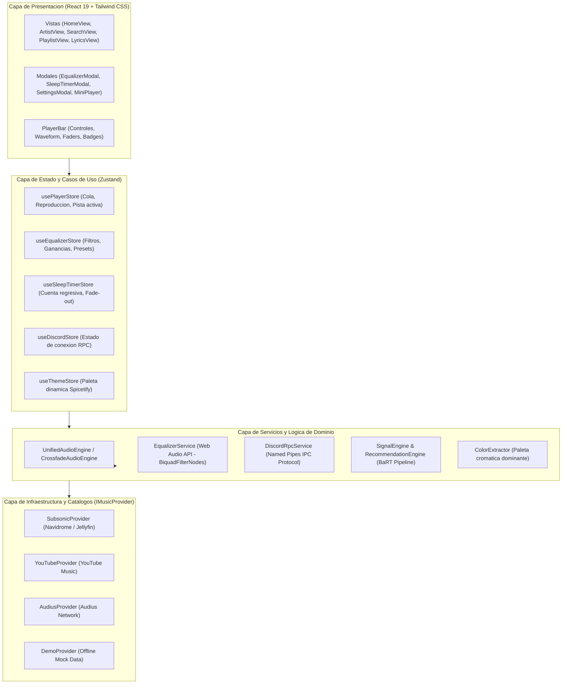

# Harmonia Desktop Music Player

<div align="center">

**Reproductor de musica de escritorio rapido, moderno y de codigo abierto inspirado en la arquitectura de Spotify Desktop.**  
Desarrollado con **Tauri v2**, **React 19**, **TypeScript** y **Tailwind CSS**. Compatible con el estandar **Subsonic / Navidrome**, **YouTube Music**, **Audius** y **Web Audio API**.

[](LICENSE)
[](https://tauri.app)
[](https://react.dev)
[](https://www.typescriptlang.org)
[](https://tailwindcss.com)
[](https://www.navidrome.org)
[](https://discord.com)

</div>

---

## Indice de Contenidos

- [Descripcion General](#descripcion-general)
- [Caracteristicas Principales](#caracteristicas-principales)
  - [1. Motor de Audio Profesional y Transiciones DJ](#1-motor-de-audio-profesional-y-transiciones-dj)
  - [2. Ecualizador Grafico Multibanda de 64 Bits](#2-ecualizador-grafico-multibanda-de-64-bits)
  - [3. Discord Rich Presence Nativo](#3-discord-rich-presence-nativo)
  - [4. Temporizador de Desconexion Nocturna (Sleep Timer)](#4-temporizador-de-desconexion-nocturna-sleep-timer)
  - [5. Motor de Recomendacion Algoritmica (Spotify BaRT REA)](#5-motor-de-recomendacion-algoritmica-spotify-bart-rea)
  - [6. Catalogo Multi-Fuente](#6-catalogo-multi-fuente)
  - [7. Perfil de Artista y Navegacion Completa](#7-perfil-de-artista-y-navegacion-completa)
  - [8. Menu Contextual Glassmorphism y UI Moderna](#8-menu-contextual-glassmorphism-y-ui-moderna)
- [Arquitectura del Sistema (Clean Architecture y SOLID)](#arquitectura-del-sistema-clean-architecture-y-solid)
- [Estructura del Proyecto](#estructura-del-proyecto)
- [Guia de Inicio Rapido](#guia-de-inicio-rapido)
  - [Requisitos Previos](#requisitos-previos)
  - [Instalacion y Modo Desarrollo](#instalacion-y-modo-desarrollo)
  - [Servidor Personal con Docker (Navidrome)](#servidor-personal-con-docker-navidrome)
  - [Compilacion para Produccion](#compilacion-para-produccion)
- [Atajos de Teclado](#atajos-de-teclado)
- [Licencia](#licencia)

---

## Descripcion General

Harmonia es un reproductor de audio de escritorio disenado mediante **Ingenieria Inversa de Arquitectura (REA)** sobre el cliente oficial de Spotify Desktop y adaptado a estandares abiertos de streaming y computacion eficiente.

A diferencia de clientes construidos sobre frameworks pesados basados en Electron (que suelen demandar entre 400 MB y 800 MB de memoria RAM), Harmonia opera mediante el runtime optimizado de **Tauri v2** sobre WebView2 nativo y Rust, manteniendo el consumo promedio por debajo de los **40 MB de RAM** con arranque practicamente instantaneo.

El proyecto implementa principios **SOLID** y **Clean Architecture**, desacoplando el transporte de audio fisico, los proveedores de catalogo, el estado reactivo con Zustand y la capa de presentacion visual Glassmorphism.

---

## Caracteristicas Principales

### 1. Motor de Audio Profesional y Transiciones DJ
- **Crossfade DJ de Doble Canal (`CrossfadeAudioEngine`):** Reproduccion continua de audio sin cortes (Gapless Playback) entre canciones utilizando una curva de potencia constante (*Equal-Power Curve*: `FadeOut = cos(p * pi/2)`, `FadeIn = sin(p * pi/2)`).
- **Proteccion Anti-Pop:** Micro-atenuaciones (*micro-fades*) de 150 ms al pausar, reanudar o conmutar de pista para evitar artefactos audibles y proteger altavoces y auriculares.
- **Doble Buffer Estereo:** Soporte para Canal A y Canal B con intercambio dinamico de fuentes.

### 2. Ecualizador Grafico Multibanda de 64 Bits
- **Web Audio API de Alta Precision (`EqualizerService`):** Cadena en serie de 6 filtros `BiquadFilterNode` con frecuencias exactas de Spotify Desktop:
  - **60 Hz:** Lowshelf (Sub-graves y bombos profundos).
  - **150 Hz:** Peaking (Graves y cuerpo ritmico).
  - **400 Hz:** Peaking (Medios bajos y calidez instrumental).
  - **1.0 kHz:** Peaking (Medios vocales e inteligibilidad).
  - **2.4 kHz:** Peaking (Medios altos y presencia de cuerdas/cajas).
  - **15.0 kHz:** Highshelf (Agudos y brillo cristalino).
- **Rango:** Ajustable de **-12 dB a +12 dB** con precision de 0.5 dB.
- **Preajustes de Fabrica:** Incluye perfiles oficiales (*Plano, Refuerzo de graves, Reduccion de graves, Electronica / Dance, Rock, Hip-Hop / Trap, Acustica, Realce vocal, Clasica / Orquestal* y modo *Personalizado*).
- **Curva Spline Dinamica:** Visualizador SVG en tiempo real con degradado interactivo y faders verticales con memoria y centrado a 0 dB con doble clic.
- **Bypass Transparente:** Conmutacion On/Off instantanea mediante transiciones suaves sin desconectar nodos ni reiniciar la sesion de audio.

### 3. Discord Rich Presence Nativo
- **Sincronizacion por Named Pipes de Windows:** Conexion directa mediante el socket de sistema `\\.\pipe\discord-ipc-0` a traves de middleware dedicado en el servidor.
- **Visualizacion en Tiempo Real:** Muestra en tu perfil de Discord la cancion actual, nombre del artista, caratula oficial y timestamps sincronizados con la barra de progreso en vivo.
- **Control Total:** Interruptor On/Off en el panel de ajustes con indicador visual de conexion.

### 4. Temporizador de Desconexion Nocturna (Sleep Timer)
- **Modos de Apagado:**
  - Por duracion fija: 5 min, 10 min, 15 min, 30 min, 45 min, 1 hora o selector deslizante de 1 a 120 minutos.
  - Al finalizar la pista actual (*End of current track*): Espera a que termine la cancion en curso sin interrumpir el compas final.
- **Desvanecimiento Suave:** Aplica un fade-out de volumen durante los ultimos 3 segundos antes de pausar la reproduccion, evitando interrupciones bruscas.
- **Acceso Rapido:** Boton con icono de luna en la barra de reproduccion con badge numerico de tiempo restante y extension instantanea de +5 minutos.

### 5. Motor de Recomendacion Algoritmica (Spotify BaRT REA)
- **Algoritmo Hibrido BaRT (Bandits for Recommendations as Treatments):** Balanceo dinamico entre explotacion (canciones del mismo artista) y exploracion (artistas similares y pares de colaboracion).
- **Grafo de Generos y Colaboraciones:** Base de conocimiento de afinidad para generos como Trap Latino, Reggaeton, Pop, Hip-Hop y Rock.
- **Actualizacion Reactiva en Vivo:** Detecta el artista de la sesion actual al reproducir cualquier cancion y adapta automaticamente la mezcla de la pantalla de inicio sin requerir recargar la pagina.
- **Cola Infinita Autonoma:** Al restar 2 canciones para agotar la cola, solicita proactivamente un nuevo lote de canciones similares para mantener la musica sonando ininterrumpidamente.

### 6. Catalogo Multi-Fuente
- **Navidrome / Subsonic:** Streaming de alta fidelidad desde servidores personales mediante protocolo REST con autenticacion segura MD5 (soporte para FLAC, MP3, AAC y streaming por rangos HTTP).
- **YouTube Music (Estudio Oficial):** Busqueda y reproduccion de grabaciones oficiales de estudio, descartando versiones remix no autorizadas o slowed de baja fidelidad.
- **Audius:** Catalogo descentralizado de musica independiente y electronica.
- **Modo Demo Local:** Pistas preinstaladas de prueba para experimentar la interfaz sin requerir conexion a internet ni credenciales.

### 7. Perfil de Artista y Navegacion Completa
- **Vista de Artista (`ArtistView`):** Cabecera cinematografica con insignia de verificacion, conteo de oyentes mensuales, boton de Seguir/Siguiendo, Top 5 pistas mas escuchadas, discografia completa y carrusel de artistas relacionados (*A los fans tambien les gusta*).
- **Navegacion Bidireccional:** Historial de navegacion adelante/atras integrado en el encabezado.

### 8. Menu Contextual Glassmorphism y UI Moderna
- **Menu de Clic Derecho:** Accesible sobre cualquier pista en cualquier seccion de la app (*Ir al artista, Agregar a la cola, Iniciar radio, Agregar a lista, Ver letras, Me gusta, Copiar enlace*).
- **Letras Sincronizadas (`LyricsView`):** Modo karaoke con sincronizacion por marcas de tiempo en milisegundos y scroll automatico.
- **Mini-Reproductor Flotante (PiP):** Ventana compacta estilo widget para controlar la musica mientras trabajas en otras aplicaciones.
- **Motor de Temas Spicetify:** Soporte para paletas dinamicas y fondos ambientales reactivos que adaptan su matiz de color a la portada de la cancion en reproduccion.

---

## Arquitectura del Sistema (Clean Architecture y SOLID)



---

## Estructura del Proyecto

```text
REA-Spo/
├── src/
│   ├── components/            # Componentes modulares UI
│   │   ├── Views/             # Vistas (HomeView, ArtistView, SearchView, etc.)
│   │   ├── EqualizerModal.tsx # Ecualizador grafico de 6 bandas
│   │   ├── SleepTimerModal.tsx# Temporizador de desconexion
│   │   ├── PlayerBar.tsx      # Barra persistente de reproduccion
│   │   ├── SettingsModal.tsx  # Configuracion de servidores y audio
│   │   ├── TrackContextMenu.tsx # Menu contextual de clic derecho
│   │   └── ...
│   ├── contracts/             # Interfaces de desacoplamiento (ISP / DIP)
│   │   ├── audio.ts           # Interfaz IAudioEngine
│   │   └── provider.ts        # Interfaz IMusicProvider
│   ├── hooks/                 # Hooks reactivos (useKeyboardShortcuts, useDiscordRpc, etc.)
│   ├── services/              # Logica de negocio y motores
│   │   ├── audio/             # EqualizerService, CrossfadeAudioEngine, HTML5AudioEngine
│   │   ├── discord/           # DiscordRpcService
│   │   ├── recommendation/    # RecommendationEngine, SignalEngine
│   │   ├── color/             # ColorExtractor
│   │   └── providers/         # SubsonicProvider, YouTubeProvider, AudiusProvider
│   ├── stores/                # Stores de estado global Zustand
│   ├── types/                 # Definiciones de tipos TypeScript
│   ├── App.tsx                # Orquestador raiz
│   └── App.css                # Estilos Glassmorphism y utilidades de Spicetify
├── src-tauri/                 # Backend nativo en Rust (Tauri v2)
│   ├── src/
│   │   ├── lib.rs             # Bandeja del sistema, atajos y gestion de ventanas
│   │   └── main.rs
│   ├── Cargo.toml             # Dependencias del nucleo en Rust
│   └── tauri.conf.json        # Configuracion de la ventana de escritorio
├── docker/                    # Entorno listo para servidor de musica
│   └── docker-compose.yml     # Despliegue de Navidrome con 1 comando
├── vite.config.ts             # Servidor Vite con middleware de YouTube y Discord IPC
├── package.json               # Dependencias de frontend
└── tsconfig.json              # Configuracion de compilacion TypeScript
```

---

## Guia de Inicio Rapido

### Requisitos Previos
- **Node.js:** Version 18.0.0 o superior instalada.
- **npm:** Gestor de paquetes incluido con Node.js.
- **Git:** Control de versiones instalado.
- *(Opcional)* **Docker Desktop:** Si deseas hospedar tu servidor personal de musica Navidrome localmente.

### Instalacion y Modo Desarrollo

1. Clona el repositorio:
   ```bash
   git clone https://github.com/Carlos-jim/harmonia.git
   cd harmonia
   ```

2. Instala las dependencias del proyecto:
   ```bash
   npm install
   ```

3. Inicia el servidor de desarrollo:
   ```bash
   npm run dev
   ```
   Abre tu navegador en `http://localhost:1420/` para explorar la aplicacion con Hot Module Replacement (HMR).

### Servidor Personal con Docker (Navidrome)

Si deseas conectar tu propia biblioteca de archivos de musica (`.mp3`, `.flac`, `.m4a`):

1. Coloca tus archivos en la carpeta `docker/music/`.
2. Inicia el contenedor de Navidrome:
   ```bash
   cd docker
   docker compose up -d
   ```
3. Abre `http://localhost:4533` en tu navegador para crear las credenciales iniciales de administrador.
4. En Harmonia, abre **Ajustes** (icono de engranaje superior o atajo de servidor) y selecciona la pestana **Navidrome** para ingresar tu usuario y contrasena.

### Compilacion para Produccion

Para verificar tipos y compilar el bundle optimizado para distribucion:

```bash
# Comprobacion de tipos estricta sin emision
npx tsc --noEmit

# Compilacion web de produccion
npm run build
```

Para generar el ejecutable nativo de escritorio de Windows (`.exe` o instalador `.msi`):

```bash
npm run tauri build
```

---

## Atajos de Teclado

Harmonia incluye atajos de teclado globales para controlar la reproduccion sin levantar las manos del teclado:

| Tecla | Accion |
| :--- | :--- |
| **Espacio** | Reproducir / Pausar |
| **Flecha Derecha** | Avanzar 5 segundos en la pista |
| **Flecha Izquierda** | Retroceder 5 segundos en la pista |
| **Flecha Arriba** | Subir volumen (+5%) |
| **Flecha Abajo** | Bajar volumen (-5%) |
| **M** | Silenciar / Activar sonido (Mute) |
| **N** | Siguiente cancion (Next track) |
| **P** | Cancion anterior (Previous track) |
| **S** | Alternar modo aleatorio (Shuffle) |
| **R** | Alternar modo repeticion (Repeat / Repeat 1) |
| **L** | Marcar o quitar de tus Me Gusta (Like) |
| **E** | Abrir o cerrar el Ecualizador Grafico (EQ) |

---

## Licencia

Este proyecto esta licenciado bajo los terminos de la [Licencia MIT](LICENSE). Codigo abierto y libre para la comunidad.
